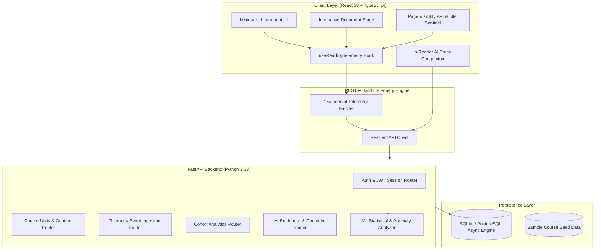
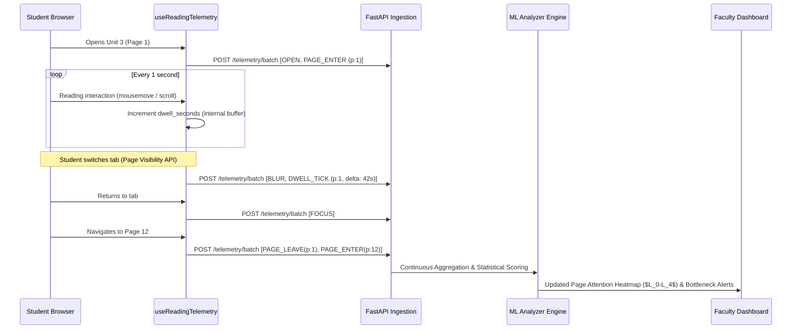

# LearnTrack AI — Technical Architecture

This document outlines the system architecture, data pipeline, privacy mechanics, and machine learning telemetry models powering LearnTrack AI.

---

## 1. High-Level System Architecture

---

## 2. Telemetry Pipeline & Privacy Boundary

LearnTrack AI enforces an uncompromising privacy boundary:

### Telemetry Event Types
- `OPEN`: Reading session initialized.
- `PAGE_ENTER`: Student navigates to a new page.
- `PAGE_LEAVE`: Student transitions away from current page.
- `DWELL_TICK`: Batched active dwell increment (flushed every 15s or upon page switch).
- `BLUR`: Browser tab lost focus or window minimized (dwell timer automatically frozen).
- `FOCUS`: Browser tab regained active focus (dwell timer resumed).
- `IDLE_PAUSE`: Inactivity detected (>60 seconds without mouse, scroll, or keyboard event).
- `CLOSE`: Reading session terminated.

---

## 3. Machine Learning Models & Statistical Scoring

### 3.1 Dwell Heatmap Scoring ($L_0$ to $L_4$)
To represent collective attention, page dwell times are normalized against cohort distributions:
$$L(p) = \min\left(4, \left\lfloor \frac{\bar{t}_p}{t_{\max}} \times 5 \right\rfloor\right)$$
Where:
- $\bar{t}_p$ is the mean active viewing duration on page $p$.
- $t_{\max}$ is the peak reference dwell for the document.

### 3.2 Automated Bottleneck Detection
A document section $[p_{\text{start}}, p_{\text{end}}]$ is categorized as a learning bottleneck when:
$$\bar{t}_{\text{section}} \ge \mu_{\text{cohort}} + 0.8 \cdot \sigma_{\text{cohort}}$$
$$\sum_{p \in \text{section}} R_p \ge \theta_{\text{revisit}}$$
Such pages trigger proactive pedagogical recommendations for the instructor (e.g. topic recaps in upcoming lectures).

### 3.3 Engagement Archetype & Anomaly Detection
The telemetry engine applies multi-feature classification:
1. **Rapid Navigation Anomaly**:
   $$\text{Completion} \ge 80\% \quad \text{and} \quad T_{\text{active}} < 8\text{ minutes}$$
   Identifies potential automated skimming or script execution.
2. **High Revisit Churn**:
   $$R_{\text{total}} \ge 12$$
   Flags non-linear reading oscillation between technical proofs and formulas.
3. **Disengaged / At-Risk**:
   $$\text{Completion} < 50\% \quad \text{and} \quad T_{\text{active}} < 20\text{ minutes}$$
   Identifies students falling behind syllabus timelines.
4. **Deep Sustained Reading**:
   $$\text{Completion} \ge 80\% \quad \text{and} \quad T_{\text{active}} \ge 30\text{ minutes}$$
   Reflects healthy linear reading habits.

---

## 4. Database Schema

- **`users`**: User identities, email, role (`faculty` or `student`).
- **`courses`**: Course metadata (`CS3104 Machine Learning`, Section A).
- **`course_units`**: Syllabus units (`Unit 3: Regularization`, total pages, assigned date).
- **`unit_pages`**: Page-level curriculum content, key concept, estimated reading time.
- **`reading_sessions`**: Session start, completion percentage, active duration.
- **`page_telemetry`**: Aggregated dwell seconds and revisit tallies per page per student.
- **`telemetry_events`**: Raw event log stream for debugging and transparent audit.

---

## 5. Security & Privacy Guardrails

1. **FERPA Strict Isolation**: Student identifiers are strictly decoupled from external third-party aggregators.
2. **No Biometric or Surveillance Vectors**: Zero WebRTC camera queries, zero WebAudio listeners, zero screen capture APIs.
3. **Transparent Audit Logging**: The student can inspect their own emitted telemetry events in real-time inside the reader interface.
